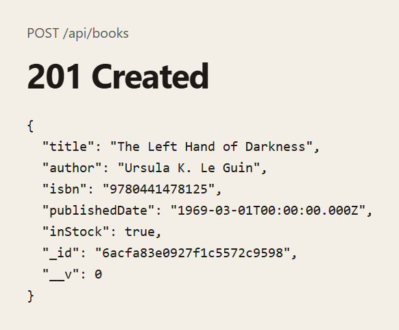
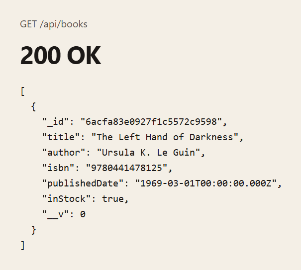
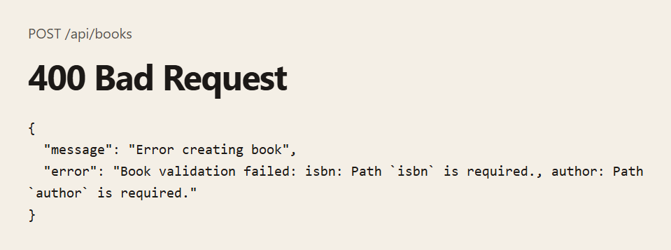
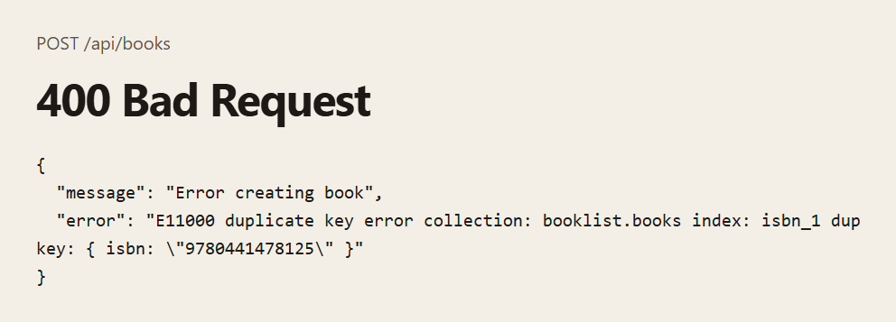
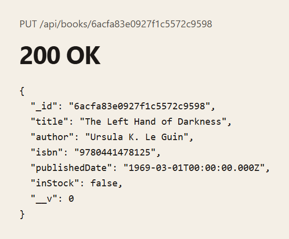
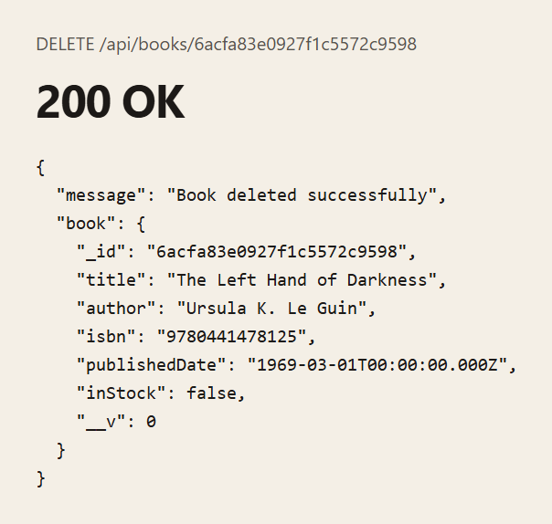
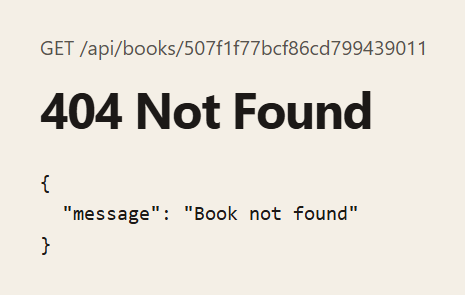

# Digital Bookshelf API

An Express API for a bookshelf. Books are stored in MongoDB with a Mongoose model. The server connects before it starts listening, then exposes create, read, update, and delete routes under `/api/books`.

There is no HTML page. These screenshots are the JSON the API returned while the server was running.

## Screenshots

**Create.** `POST /api/books` saves the book and returns it. `publishedDate` comes back as an ISO date.



**List.** `GET /api/books` returns every book. This list is the book from the create request. An empty collection returns `[]`.



**Missing fields.** `title`, `author`, and `isbn` are required. This body had only a title.



**Duplicate ISBN.** `isbn` is unique. Sending the same ISBN again returns 400.



**Update.** `PUT /api/books/:id` with `{ "inStock": false }` returns the updated book.



**Delete.** `DELETE /api/books/:id` returns the deleted book. A later `GET` for that id returns 404.



**Unknown id.** A real ObjectId that is not in the collection returns 404.



## Getting started

```bash
npm install
npm start
```

The server reads `.env` and listens on `http://localhost:3000` unless `PORT` is set.

| Variable | Purpose |
| --- | --- |
| `MONGO_URI` | MongoDB connection string |
| `PORT` | Port for Express. Defaults to 3000 |

| Command | What it does |
| --- | --- |
| `npm start` | Run `server.js` with Node |
| `npm run dev` | Run `server.js` with nodemon |

## Book fields

| Field | Rule |
| --- | --- |
| `title` | Required string |
| `author` | Required string |
| `isbn` | Required string, unique |
| `publishedDate` | Optional date |
| `inStock` | Boolean, defaults to `true` |

## Routes

Send JSON with `Content-Type: application/json`.

### `POST /api/books`

```json
{
  "title": "The Left Hand of Darkness",
  "author": "Ursula K. Le Guin",
  "isbn": "9780441478125",
  "publishedDate": "1969-03-01",
  "inStock": true
}
```

Returns `201` and the saved book, including `_id` and `__v`. Returns `400` when a required field is missing or the ISBN is already stored.

### `GET /api/books`

Returns `200` and an array of books.

### `GET /api/books/:id`

Returns `200` and one book. Returns `404` with `{ "message": "Book not found" }` when the id is a valid ObjectId and no book uses it.

An id that is not an ObjectId, such as `not-an-id`, returns `500`:

```json
{
  "message": "Error fetching book",
  "error": "Cast to ObjectId failed for value \"not-an-id\" (type string) at path \"_id\" for model \"Book\""
}
```

### `PUT /api/books/:id`

Replaces the sent fields and returns the updated book. Schema rules run on the update. Setting `title` to an empty string returns `400`, and the error says that title is required. A valid id that matches no book returns `404`. An id that is not an ObjectId returns `400` with `Error updating book`.

### `DELETE /api/books/:id`

Returns `200` with `Book deleted successfully` and the removed book. A valid id that matches no book returns `404`. An id that is not an ObjectId returns `500` with `Error deleting book`.
